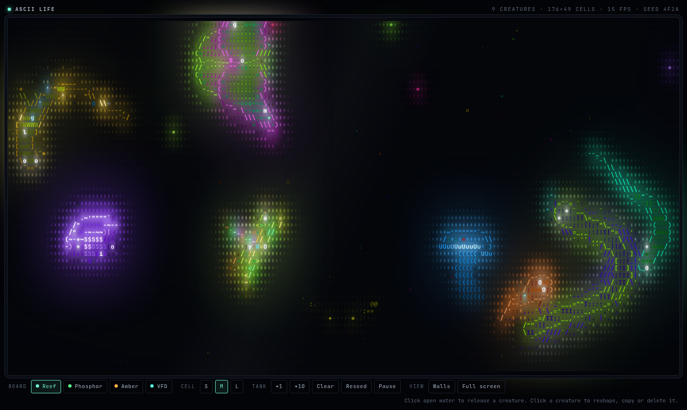

# ascii-life

A lit character board of procedurally animated ASCII creatures. Nothing is a sprite: every creature is a small
block of genome data, simulated in pixel space and then written into a grid of character cells.

**Live:** https://nickcason.github.io/ascii-life/



Works on a desk and on a phone, installs as an app, and runs offline once loaded.

## Run it

Open `index.html` in a browser, or `node tests/serve.js` and visit the address it prints (installing and offline
use need http). No build step, no dependencies.

- **Click or tap open water** to release a random creature there.
- **Click or tap a creature** to open its card. A creature is a *base* plus a *name*:
  - *Base buttons* turn it into another body. The name stays, and with it the size, colours and glow.
  - *The name box* reseeds it. The same name on the same base always makes the same creature.
  - *Shuffle* writes a random name. *Copy* and *Copy ×10* duplicate it. *Delete* removes it.
- **Walls** keeps every creature inside a lit frame. On by default on phones.
- **Full screen** makes the board the whole window. On a phone it always is; controls sit behind the ≡ button.

Words in a name are obeyed:

| | words |
|---|---|
| base | snake, eel, dragon, fish, koi, squid, ray, jelly, medusa, lizard, gecko, newt, axolotl, centipede, beetle, bug, butterfly, moth, dragonfly, wisp, firefly … |
| colour | red, orange, amber, gold, yellow, lime, green, mint, teal, cyan, sky, blue, indigo, violet, purple, magenta, pink, rose … |
| size, pace | tiny, small, big, huge, giant · slow, lazy, fast, quick, swift |
| shape | long, short, fat, thin, spiky |
| light | bright, dim, sparkly, strobe, ghost (white body), rainbow (hue runs the length of it) |

Symbols typed in a name (`#@%`, `<>~`) become the creature's skin. Letters join the set that twinkles through it.

URL options: `?seed=4f2a` (hex), `&theme=reef|phosphor|amber|vfd`, `&cell=s|m|l`, `&walls=1|0`, `&solo=fish&name=tiny+red+squid`.
Keys: space pauses, `r` reseeds, `t` cycles the board, `w` walls, `f` full screen, Esc closes, Delete removes the selection.

## Creatures

Every name draws a set of traits that hold in any body: size (about ×0.5 to ×2), pace, one of seven colour schemes
(including a hue that drifts along the body), one of five glow behaviours (travelling wave, throb, chasing dots,
steady, strobe), a texture and an outline style. The base then draws one of its forms:

| base | forms | how it moves |
|---|---|---|
| serpent | eel, viper, ribbon, worm, dragon | a wave runs head to tail and grows as it goes; the body slips through the water slower than its own wave |
| fish | torpedo, disc, needle, puffer, tadpole, ray, squid, angler, betta | stiff front, working tail; most beat in bursts then glide, rays beat their fins like wings, squid jet and trail tentacles, anglers carry a lamp |
| jellyfish | moon, lion, box, comet, bloom | the crown squeezes, the rim follows, it surges and coasts; each pulse sends a wave down the tentacles |
| lizard | gecko, skink, monitor, axolotl, horned, newt | trot: diagonal feet move as pairs, planted feet stay planted, the trunk bends in time |
| crawler | centipede, millipede, beetle, isopod, silverfish | a stepping wave runs down the legs at each form's own lag; beetles walk a tripod |
| butterfly | classic, swallowtail, moth, skipper, atlas, glasswing | seen from above: wings foreshorten as they rise; flaps, glides, and perches to bask |
| dragonfly | hawker, damsel, darter | hovers, pivots on the spot, darts in a straight line |
| wisp | mote, comet, swarm | a blinking mote with a fading tail, sometimes with companions in orbit |

Big bodies sweep wide arcs and step slowly; small ones dart. Nothing is allowed to outgrow the board it is on.

## How it draws

- **Shapes** are signed-distance capsules and ellipses. The outermost ring of cells becomes the outline; the glyph
  is chosen by which way the edge runs and, for near-level edges, by where it crosses the cell (`_ . - ' "`).
- **Skins** fill the inside: depth ramps, bands, checks, mottling, spots, stripes, and glyphs that point the way the
  animal is heading.
- **Twinkle**: a small share of a creature's cells briefly become some other bright symbol.
- **Light** is faked from the board itself. The lamps sit on a grid, so the light falling anywhere is a blurred copy of
  what the board is emitting. That blur is done in script on a cols×rows field at three ranges: a tight glow around
  the glyphs, the light reaching the unlit lamps nearby (each lamp shows the colour that reaches it), and a wide wash
  that carries past the bezel. The wall frame is lit the same way. No CSS blur, mask or blend layers are used, so the
  cost is the same on a phone as on a desktop.

## Layout

- `js/sim.js`: genomes, simulation, rasteriser, hit-testing. No DOM, so it also runs in Node.
- `js/app.js`: canvases, light, themes, the creature card, controls.
- `manifest.webmanifest`, `sw.js`, `icons/`: install and offline. The worker is network-first, so a deploy shows up
  as soon as you are online. `tools/make-icons.js` regenerates the icons from `tools/icon.html`.
- `tests/motion.test.js`: 225 checks against the simulation itself, run over every form of every base: feet that
  must not slide, waves that must run the right way, wings in step, walls that must hold, names that must rebuild the
  same creature, how wide the variety really is, and a fuzz pass over random names and word combinations.
- `tests/browser.test.js`: 67 checks in a real browser (Playwright + Chromium) on desktop and an emulated phone,
  including install metadata and starting with the network off. Set `ASCII_LIFE_URL` to test a deployed copy.
- `tests/frames.js`: prints a creature as text, moment by moment: `node tests/frames.js fish form:squid 4 0.2`.

```
npm install      # Playwright, for the browser checks only
npm test
```
